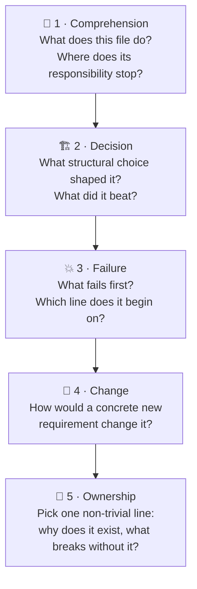
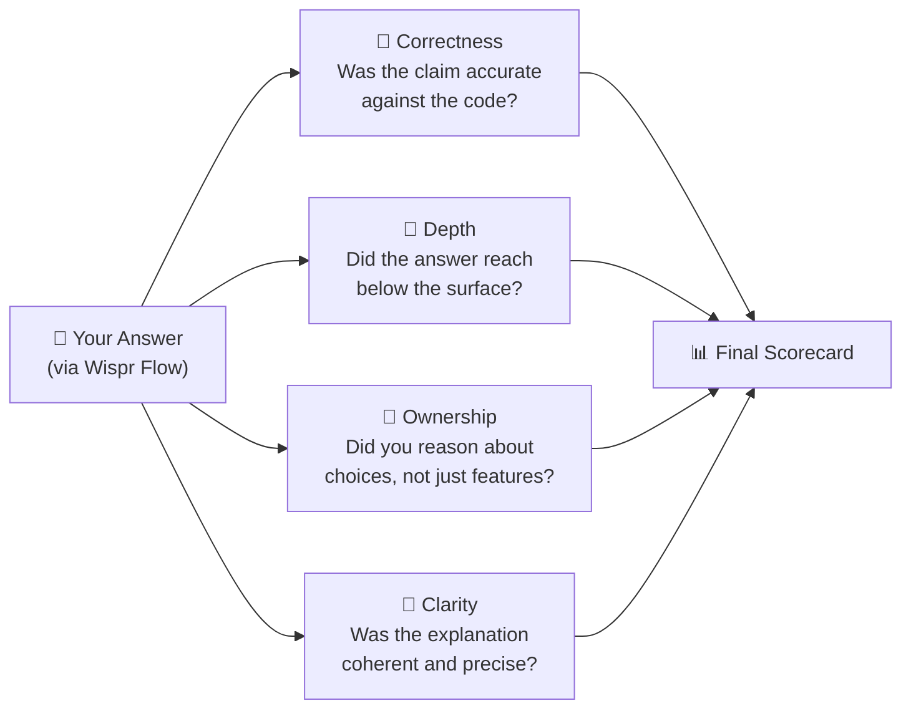

<div align="center">

# 🎓 Viva

### _The oral exam for code._

**Paste a file. Answer five questions out loud. Get a scorecard that quotes your words back — with exact line numbers.**

[](https://viva-oral-exam.vercel.app)
[](https://viva-oral-exam.vercel.app/demo)
[](https://www.youtube.com/watch?v=jk2OX-Oi118)
[](https://viva-oral-exam.vercel.app)

> **"In 2026, anyone can ship code with AI. Almost nobody can defend a line of it.**
> **Explanation is the scarce signal. Viva finds it."**

</div>

---

## The Problem

Code reviews test style. CI tests correctness. Linters test syntax.

**Nothing tests understanding.**

An engineering manager needs to know: does this person _own_ their code, or did they just ship it? A developer preparing for interviews needs to know: can they defend what they built, or only describe it?

Today the only answer is a 30-minute verbal interview, squeezed into a calendar slot, with no transcript, no evidence, and no consistency.

**Viva is that interview — structured, instant, and voice-first.**

---

## What Viva Does

### Step 1 — Ingest a file

Paste code directly, or browse any public GitHub repository and pick a file. The code stays visible throughout the entire exam.

### Step 2 — The Question Ladder

Viva builds five deliberate questions — one concept per rung, each harder to fake than the last.



### Step 3 — Answer out loud with Wispr Flow

Wispr Flow types into the answer box exactly as it would into any other field.

- **No microphone permission** requested
- **No audio** recorded or retained
- **No transcription pipeline** — plain text in, plain text stored

### Step 4 — Adaptive probes

When an answer is vague, Viva quotes your own words back and asks the follow-up a great interviewer would ask.

```
Answer → Vague? ──Yes──▶ Quote your words back → Probe question
                 │
                No
                 │
                 ▼
          Next rung of the ladder
```

Bounded at **2 probes per question** and **8 total turns** — enough pressure to reveal reasoning, not enough to feel like an interrogation.

### Step 5 — A scorecard with receipts

Every score points to a line of code and a sentence you actually said — including the killer signal: **confident but wrong**.

---

## The Report



Every axis in the scorecard includes:

> **Quote** — an exact sentence from your answer
> **Evidence** — the code line range it was measured against
> **⚠️ Confident but wrong** — flagged when a confident claim contradicts the code
> **Coaching** — improvement areas written as practical guidance, not generic advice

The full session transcript is saved. A public, redacted report link can be shared — private scores, expected answers, and evaluations are never exposed.

---

## Why Voice?

An oral exam is spoken by definition. Wispr Flow is not an add-on — it is the answer input. Remove it and the product becomes a text quiz.

The integration is deliberate:

- Viva requests **no microphone permission**
- Records and stores **no audio**
- Stores the transcript as **plain text**
- Validates every report quote as an **exact substring** of what you said

Voice changes the signal. Typing lets you edit and polish. Speaking reveals whether the understanding is actually there.

---

## Try It — Right Now

### 📺 Watch the demo video

[](https://www.youtube.com/watch?v=jk2OX-Oi118)

### 🎬 Watch three scripted demos (no setup, no quota, always available)

Open [`/demo`](https://viva-oral-exam.vercel.app/demo) to watch three authored sessions:

| Demo                            | What it shows                                                  |
| ------------------------------- | -------------------------------------------------------------- |
| **Strong explanation**          | A candidate who owns the code deeply                           |
| **Partial explanation + probe** | Viva pushing for depth when an answer is surface-level         |
| **Confident but wrong**         | The killer signal — confident, fluent, and factually incorrect |

No microphone. No API key. No model calls. Deterministic and always available — even when a provider is rate-limited.

### 🚀 Run a live viva

1. Open [**`/new`**](https://viva-oral-exam.vercel.app/new)
2. Choose a public GitHub repository and file, or paste code directly
3. Answer five questions with **Wispr Flow** (or type, if you must)
4. Follow adaptive probes when Viva pushes deeper
5. Review your scorecard, replay the session, or share your redacted report

---

## How It Works — Engineering

```
┌─────────────────────────────────────────────────────────────────┐
│                         VIVA SESSION FLOW                       │
├─────────────────────────────────────────────────────────────────┤
│                                                                 │
│  Code File  ──▶  Question Ladder  ──▶  Answer (Wispr Flow)     │
│    (ingest)        (AI-generated,          (text input)        │
│                    line-anchored)                               │
│                                                                 │
│                           │                                     │
│                           ▼                                     │
│                    Evaluation Engine                            │
│                  (axes + evidence + probes)                     │
│                           │                                     │
│                           ▼                                     │
│              Deterministic Report Scoring                       │
│           (code, not a second model, owns scores)              │
│                           │                                     │
│                           ▼                                     │
│         Scorecard with Quotes + Line References                 │
│                                                                 │
└─────────────────────────────────────────────────────────────────┘
```

### Provider Strategy

Groq won the latency bake-off. Google Gemini is the automatic fallback. Anthropic is an optional reserve.

| Provider                        | Role     | Why                                       |
| ------------------------------- | -------- | ----------------------------------------- |
| **Groq** (`gpt-oss-120b`)       | Primary  | Lowest latency; native Structured Outputs |
| **Google** (`gemini-3.8-flash`) | Fallback | High quality; AI SDK adapter              |
| **Anthropic**                   | Reserve  | Optional; enabled via config              |

Strict structured output schema on every provider:

```ts
response_format: {
  type: "json_schema",
  json_schema: { name: "evaluation", strict: true, schema: ... }
}
```

Zod schemas are converted to JSON Schema and validated again after the response. If every configured provider fails, deterministic heuristics still produce a usable session — no broken states.

### What is model-generated vs. deterministic?

| Component                                       | Owner                                  |
| ----------------------------------------------- | -------------------------------------- |
| Question ladder                                 | **Model** (line-anchored to your code) |
| Per-answer evaluation (axes, quote, probe)      | **Model**                              |
| Final scores, evidence, band, improvement areas | **Application code**                   |

The report's scores do not change because a second model rephrased them differently. Evidence is computed first, then rendered.

---

## Local Development

### Requirements

- Node.js **22+**
- pnpm **9+**
- Groq API key (primary provider)
- Google AI Studio key (fallback)
- Neon Postgres (optional; file store used locally)

### Install and run

```bash
git clone <repo-url>
cd viva
pnpm install
cp .env.example web/.env.local
```

Fill in `web/.env.local`:

```env
AI_PROVIDER=groq
GROQ_API_KEY=your_groq_key
GOOGLE_GENERATIVE_AI_API_KEY=your_google_key
MODEL_FALLBACK=openai/gpt-oss-120b
MODEL_SMART=gemini-3.8-flash
# Leave DATABASE_URL empty to use local JSON store
```

```bash
cd web && pnpm dev
# Open http://localhost:3000
```

Demos at `/demo` — live sessions at `/new`.

### Checks

```bash
pnpm exec tsc --noEmit   # Type check
pnpm exec eslint .        # Lint
pnpm build && pnpm start  # Production build
```

---

## Configuration Reference

| Variable                                | Default               | Purpose                                                    |
| --------------------------------------- | --------------------- | ---------------------------------------------------------- |
| `DATABASE_URL`                          | —                     | Neon/Postgres connection string. Empty = local JSON store. |
| `AI_PROVIDER`                           | `groq`                | Primary provider: `groq`, `google`, or `anthropic`         |
| `GROQ_API_KEY`                          | —                     | Primary Groq credential                                    |
| `GOOGLE_GENERATIVE_AI_API_KEY`          | —                     | Google Gemini fallback credential                          |
| `MODEL_FALLBACK`                        | `openai/gpt-oss-120b` | Groq model                                                 |
| `MODEL_SMART`                           | `gemini-3.8-flash`    | Google model                                               |
| `ANTHROPIC_API_KEY` / `ANTHROPIC_MODEL` | —                     | Optional reserve provider                                  |
| `ALLOW_CLAUDE_FALLBACK`                 | `false`               | Enable Anthropic reserve                                   |
| `GITHUB_TOKEN`                          | —                     | Raises GitHub API limit from 60 → 5,000 req/hr             |
| `NEXT_PUBLIC_APP_URL`                   | —                     | Canonical app origin                                       |
| `VIVA_DATA_DIR`                         | —                     | Custom directory for local JSON store                      |
| `MAX_SESSIONS_PER_DAY`                  | `20`                  | Per-browser live session limit (rolling window)            |
| `MAX_LIVE_SESSIONS_PER_DAY`             | `20`                  | Global live session limit                                  |
| `MAX_TURNS_PER_HOUR`                    | `60`                  | Per-browser turn limit                                     |

Limits are **rolling windows**, not midnight-reset counters. No login system; anonymous cookie handles ownership and quota.

---

## Deploy to Vercel

```bash
# 1. Create a Neon project and copy the pooled connection string
# 2. Create a Vercel project pointing to web/

cd viva/web
pnpm dlx vercel login
pnpm dlx vercel --prod
```

Add these **Production** environment variables in the Vercel dashboard:

```text
DATABASE_URL=<neon-pooled-connection-string>
AI_PROVIDER=groq
GROQ_API_KEY=<key>
GOOGLE_GENERATIVE_AI_API_KEY=<key>
MODEL_FALLBACK=openai/gpt-oss-120b
MODEL_SMART=gemini-3.8-flash
NEXT_PUBLIC_APP_URL=https://your-domain.vercel.app
MAX_SESSIONS_PER_DAY=20
```

Verify:

```bash
curl https://your-domain.vercel.app/api/health
# {"ok":true,"store":"postgres","llm":["groq:openai/gpt-oss-120b","google:gemini-3.8-flash"]}
```

The health endpoint confirms configuration. For provider failures, inspect Vercel Function Logs — the app logs provider, retry attempt, error name, message, and cause.

---

## API Reference

| Method   | Route                      | Purpose                                           |
| -------- | -------------------------- | ------------------------------------------------- |
| `POST`   | `/api/sessions`            | Create a session and generate the question ladder |
| `POST`   | `/api/sessions/:id/turns`  | Grade an answer; optionally create a probe        |
| `POST`   | `/api/sessions/:id/finish` | Persist the deterministic final report            |
| `GET`    | `/api/reports/:slug`       | Return a redacted public report                   |
| `DELETE` | `/api/sessions/:id`        | Delete an owned session                           |
| `GET`    | `/api/health`              | Show store type and configured providers          |

---

## Data Model

Sessions are stored in Neon Postgres as a JSONB document:

```text
viva_sessions
├── id, slug, anon_id          -- indexed identity fields
├── status                     -- created | active | finished
├── created_at, updated_at     -- lifecycle timestamps
└── data (JSONB)               -- complete SessionData
    ├── source                 -- original code file
    ├── questions[]            -- the 5-rung ladder (line-anchored)
    ├── turns[]                -- answers + evaluations + probes
    └── report                 -- final scorecard
```

The table is auto-created on first request — no migration command needed.

For local development, the same shape is written to `web/.data/sessions.json`.

---

## Security & Privacy

| Boundary               | How                                                                             |
| ---------------------- | ------------------------------------------------------------------------------- |
| Private session access | Requires anonymous owner cookie                                                 |
| Public report          | Exposes scorecard only — no expected answers, red flags, or private evaluations |
| Source code            | Treated as untrusted prompt data; instructions inside a file are not followed   |
| API keys               | Server-side only; never exposed to the browser                                  |
| Data deletion          | `DELETE /api/sessions/:id` removes session and public report completely         |

---

## Engineering Trade-offs

| Decision                     | Rationale                                                                         |
| ---------------------------- | --------------------------------------------------------------------------------- |
| One focused file per viva    | Keeps the interview concrete and the evidence auditable                           |
| Text input via Wispr Flow    | No audio pipeline, no retention, no transcription cost                            |
| Strict structured output     | Prevents malformed provider responses from reaching scoring logic                 |
| Deterministic report scoring | Scores are owned by application code, not a second LLM pass                       |
| JSONB session document       | Full transcript and report evolve together; indexes cover all lookup paths        |
| Scripted replay demos        | Judges can experience the product without credentials, microphone, or model quota |
| Anonymous cookie ownership   | Frictionless UX; no false promise of account security                             |

---

## Known Limits

- **One file per session** — this is an oral code exam, not a repository-wide review
- **Public repos only** — GitHub ingestion requires public access; paste is the universal fallback
- **Provider quota** — free tier quotas can be exhausted; scripted replays are always available
- **Cookie dependency** — clearing the anonymous cookie can make a private session inaccessible from that browser
- **Assistive signal only** — Viva is not a hiring verdict; it does not score accent, grammar, or English fluency

---

## Project Layout

```text
viva/
├── web/
│   ├── src/app/                 Next.js routes and API handlers
│   │   ├── api/                 sessions, turns, finish, reports, health
│   │   ├── new/                 ingest and live viva UI
│   │   ├── demo/                scripted replay gallery
│   │   ├── r/                   public report view
│   │   └── s/                   private session view
│   ├── src/components/          Ingest, viva, replay, report, and share UI
│   ├── src/lib/ai/              Providers, schemas, ladder, evaluation engine
│   ├── src/lib/store.ts         Neon/Postgres and local JSON persistence
│   ├── src/lib/scoring.ts       Deterministic report scoring
│   ├── src/fixtures/seeds.ts    Deterministic scripted replay sessions
│   └── package.json
├── bakeoff/                     Provider quality and latency comparison scripts
├── .env.example                 Environment variable template
├── PRD.md                       Full product requirements document
├── prompts.md                   Prompt engineering notes and Zod schemas
└── SUBMISSION.md                Hackathon submission copy
```

---

## Built With

[](https://nextjs.org)
[](https://www.typescriptlang.org)
[](https://tailwindcss.com)
[](https://neon.tech)
[](https://groq.com)
[](https://ai.google.dev)
[](https://vercel.com)
[](https://wispr.flow)

---

<div align="center">

**Built for [WeMakeDevs × Wispr Flow — No Hands: The Wispr Challenge](https://viva-oral-exam.vercel.app) · Builders track**

_If you can build it, can you speak it?_

</div>
